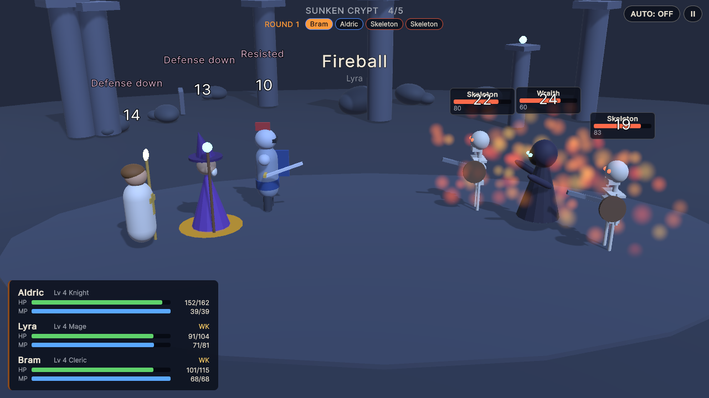
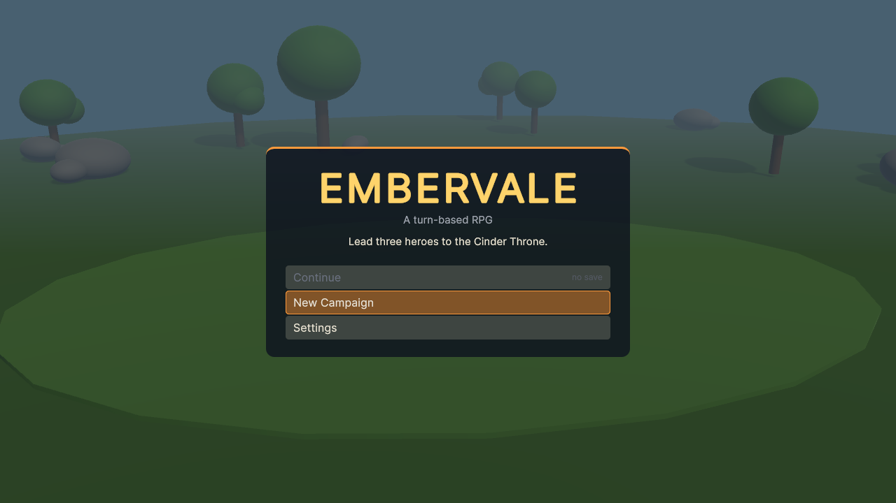
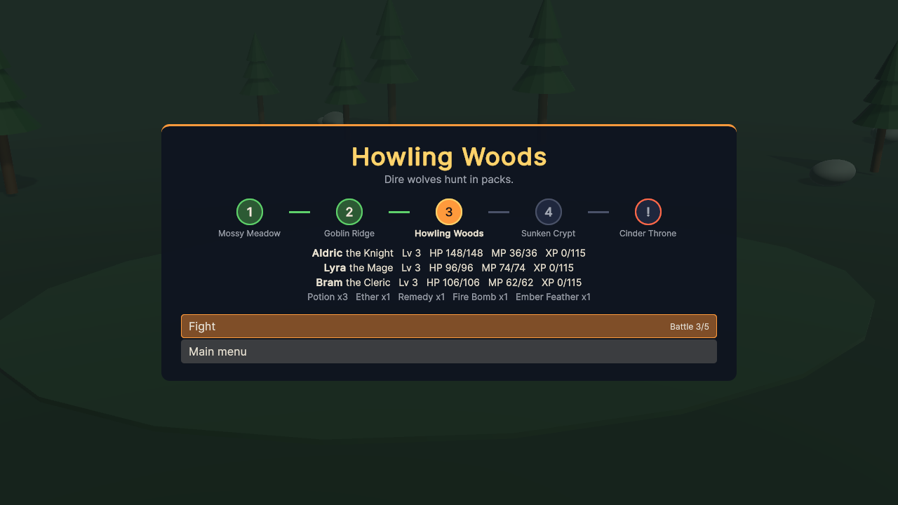
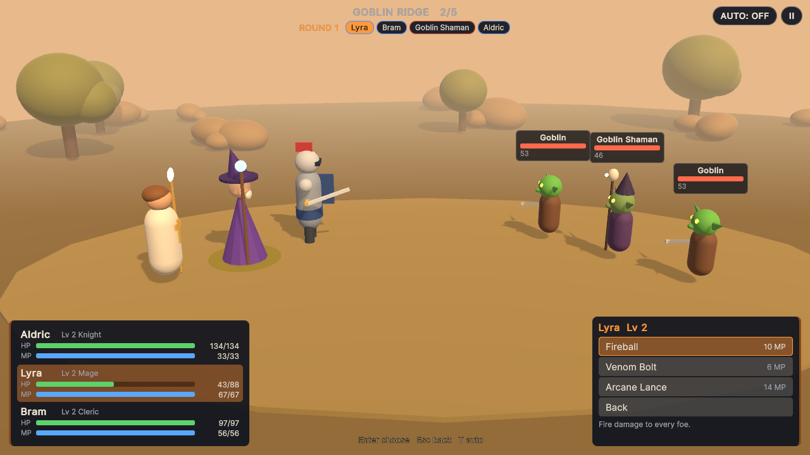
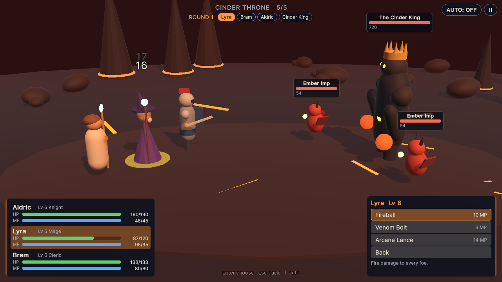
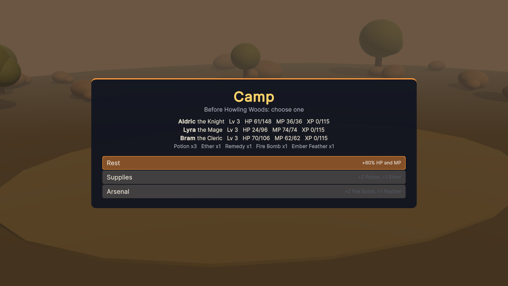
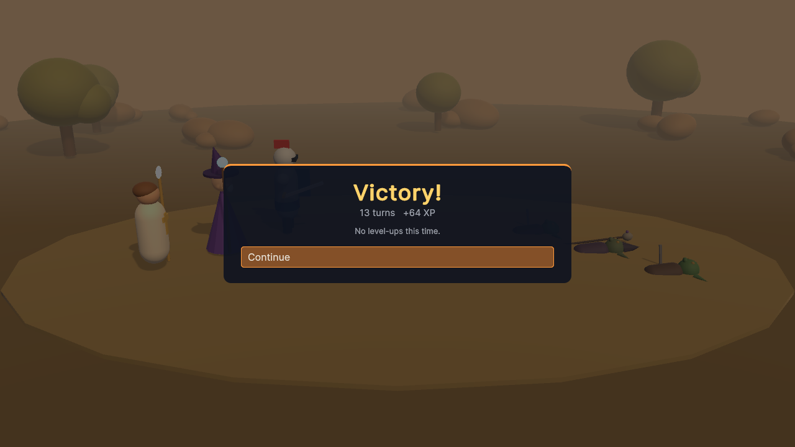

# Embervale

A small 3D turn-based RPG made with Unity: lead a knight, a mage and a cleric through five
battles to the Cinder King, with speed-based turn order, skills with MP and cooldowns, items,
status effects, an enemy AI, levels between battles and a saved campaign.



| | |
|---|---|
|  |  |
|  |  |
|  |  |

## Run it

1. Install **Unity 6000.3.27f1 (Unity 6 LTS)** with Unity Hub (add the Windows or Web build
   support module if you want to build players).
2. In Unity Hub choose **Add → Add project from disk** and select the repository folder.
3. Open `Assets/Scenes/Battle.unity` and press **Play**.

To build a player use **File → Build Profiles** (Windows or Web), or build from a terminal into
a folder outside the repository:

```bash
Unity -batchmode -quit -projectPath . -executeMethod TurnBasedRpg.EditorTools.ProjectBuilder.BuildWebGL -buildOutput ../build/web
```

(`BuildWindows` works the same way.) The WebGL build is uncompressed (about 41 MB), so it runs
from any static host such as GitHub Pages.

The tests run from **Window → General → Test Runner** (EditMode and PlayMode), or from a terminal:

```bash
Unity -batchmode -projectPath . -runTests -testPlatform EditMode -testResults editmode.xml
Unity -batchmode -projectPath . -runTests -testPlatform PlayMode -testResults playmode.xml
```

The scene, materials, panel settings, app icon and player settings are generated by
**Embervale → Regenerate Art, Scene and Player Settings** (`Assets/Editor/ProjectBuilder.cs`). The
README screenshots come from an opt-in hook:
`Unity -batchmode -projectPath . -executeMethod TurnBasedRpg.EditorTools.ProjectBuilder.CaptureScreenshots -screenshot <folder>`
(optionally `-scenario title,map,command,target,battle,boss,camp,victory`), or a built player
started with `-screenshot <folder>`.

## Controls

| Action | Keyboard | Mouse | Gamepad |
|---|---|---|---|
| Move through menus, pick a target | Arrows or WASD | Point at an entry or a fighter | D-pad or left stick |
| Choose | Enter, Space or Z | Click | A |
| Back | Backspace, X or Esc | Right button | B |
| Pause (resume, settings, restart battle, main menu) | Esc or P | **II** button | Start |
| Auto battle on/off | T | **AUTO** button | Y |
| Settings: change a value | Left / Right | Click to cycle | D-pad left / right |

## How it plays

- **Turns.** Every round, everyone alive acts from fastest to slowest (heroes first on ties).
  The strip at the top shows who is next.
- **Commands.** Attack, a Skill (costs MP, some have a cooldown in turns), an Item from the
  shared bag, or Defend (half damage until your next turn and 10% MP back). Targets show the
  expected damage before you confirm.
- **The party.**

  | Hero | Role | Skills |
  |---|---|---|
  | Aldric | Knight: tough, slow | Shield Bash (may stun), Cleave (all foes), War Cry (party Strength) |
  | Lyra | Mage: fragile, strong magic | Fireball (all foes), Venom Bolt (poison), Arcane Lance (heavy hit, Defense down) |
  | Bram | Cleric: healer | Mend (heal one), Sanctuary (heal all + Regen), Smite |

- **Damage.** Physical: attack × power − defense / 2; magical: magic × power − defense / 4;
  at least 1, ±10% variance, physical crits (10%) deal ×1.5, defending halves it.
- **Statuses.** Poison (−8% max HP each turn), Regen (+10%), Stun (skip a turn), Strength
  (attack and magic ×1.5), Weakness (defense halved), Defending.
- **Items.** Potion (60 HP), Ether (25 MP), Remedy (cures poison, stun and weakness), Fire Bomb
  (35 damage to every foe), Ember Feather (revives with 40% HP).
- **Foes.** Slimes, goblins and their shaman, dire wolves, skeletons, a wraith, ember imps and
  **the Cinder King**, a boss that gains Strength for good below half HP. The AI heals hurt
  allies, buffs its pack, goes for kills and spreads stuns and poison; it never rolls dice, so
  the same situation always gives the same choice.
- **Campaign.** Five battles: Mossy Meadow, Goblin Ridge, Howling Woods, Sunken Crypt and the
  Cinder Throne. Victories give XP (half to fallen heroes, who get back up with 1 HP), then you
  pick one camp reward: Rest (60% HP and MP), Supplies or Arsenal. Lose and the party regroups
  at full strength to retry. Progress, records (clears, fewest turns) and settings are saved.

## What I learned / technically interesting

- **Rules without the engine.** Turn order, damage, statuses, items, cooldowns, the AI,
  experience, the campaign and the save format live in `Assets/Scripts/Core`, a plain C#
  assembly with no Unity references, covered by 65 EditMode tests. A seeded xorshift generator
  makes every battle reproducible, so tests can play whole campaigns: a soak test lets the AI
  run the party through all five battles on three seeds, and another checks that the boss beats
  a level-1 party.
- **Report-driven presentation.** The core returns an `ActionReport` (every hit, heal, status,
  revive and defeat); the Unity layer only animates it: lunges, casts, hit flashes through
  material property blocks, floating numbers, particles, camera push and shake.
- **Flows that cannot leak.** Each battle is a coroutine tied to a token; leaving or restarting
  stops it, and PlayMode tests win, lose and retry, pause, and leave during the victory beat to
  prove no stale result screen appears. An Input System test fixture presses keys that go down
  and up in one frame, which is how browsers often deliver taps.
- **Everything is generated.** Heroes, monsters and scenery are built from primitive meshes in
  code; materials, the scene, the app icon and the player settings come from an editor script;
  music and sound effects come from a tiny Python synthesizer (`tools/audio`). The UI is UI
  Toolkit built in code, styled by one USS file at 1280×720 reference pixels.
- **Rescuing course work.** This started in January 2022 as the first steps of a Zenva
  turn-based RPG course: an empty battle scene, character prefabs on course-provided models and
  136 lines of scaffolding. It was upgraded to Unity 6, a null-reference bug in the party reset
  was fixed test-first, the course models and sprites were replaced, and the idea was grown into
  a complete game.

## Credits

- Base project: a Zenva course on building a 3D turn-based RPG in Unity, which this repository
  started from in 2022. None of its assets remain; see [CREDITS.md](CREDITS.md) for what was removed.
- Everything in the game was made for this project: models built in code, generated materials
  and icon, synthesized audio, and Unity's default font. See [CREDITS.md](CREDITS.md).

## License

[MIT](LICENSE)
